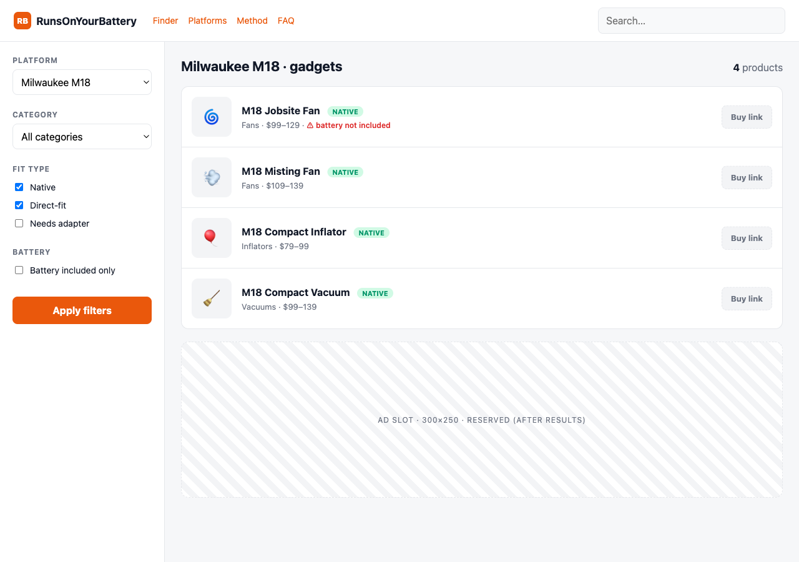
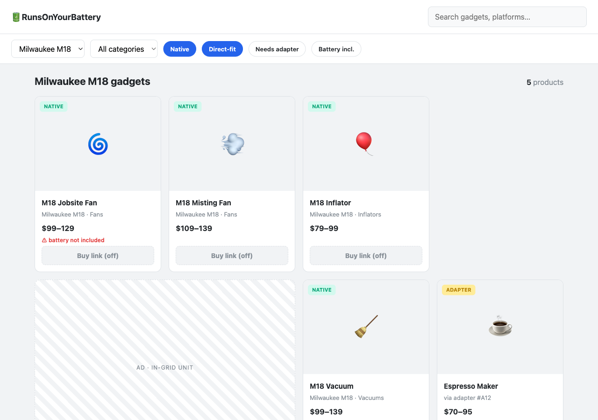
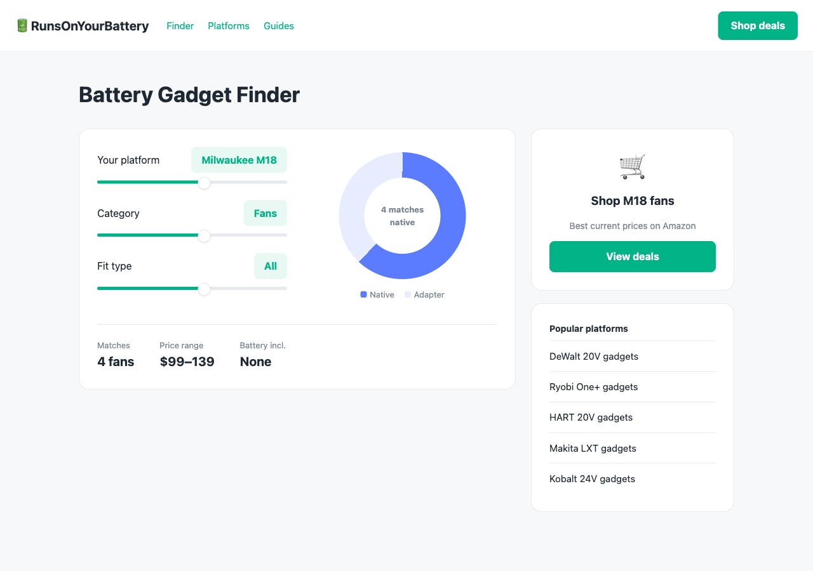
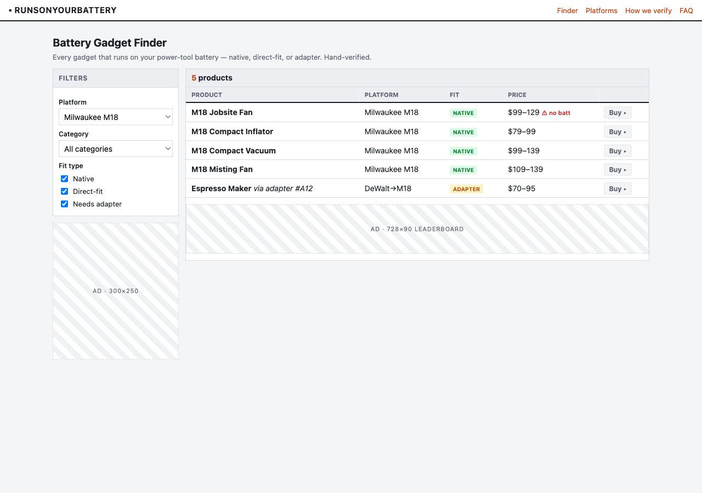
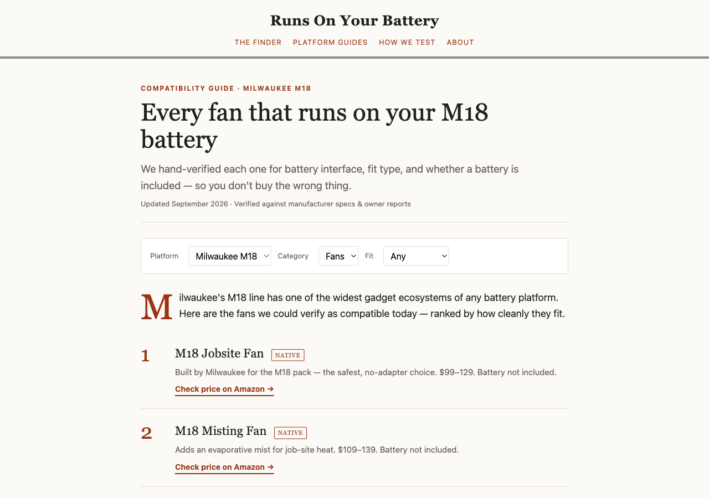
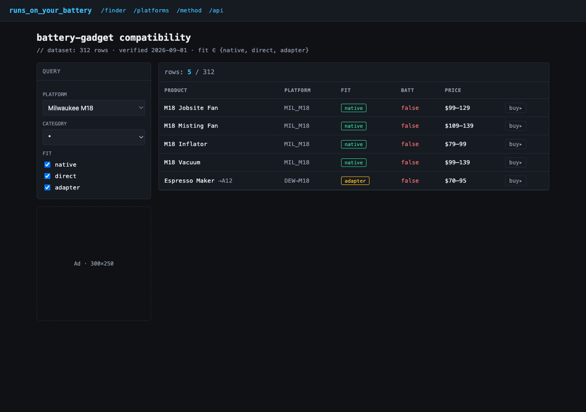
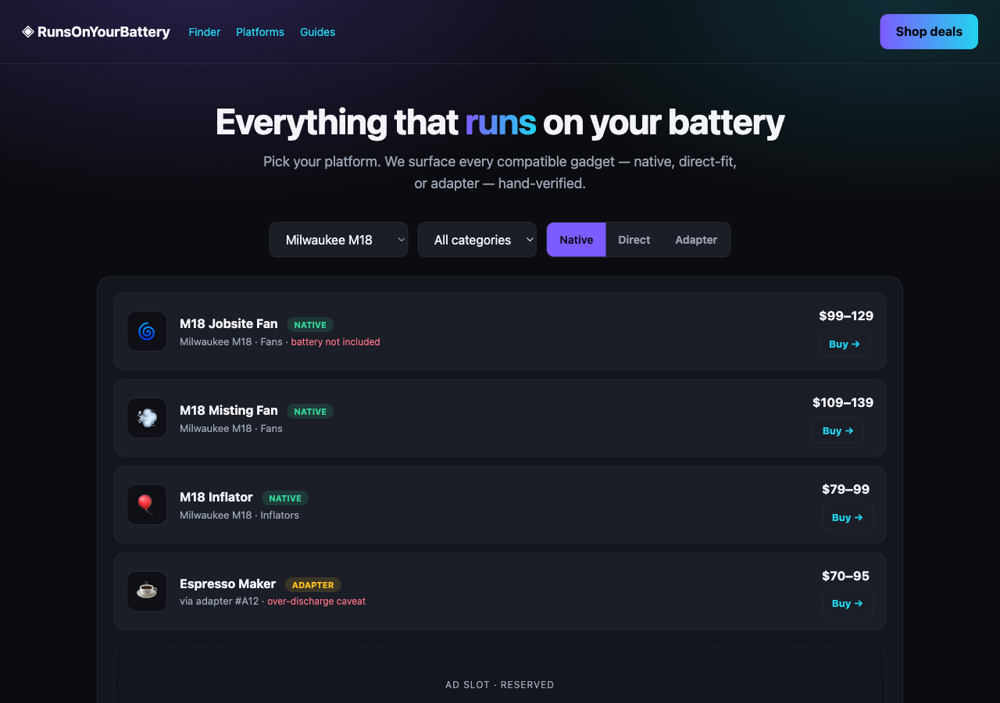
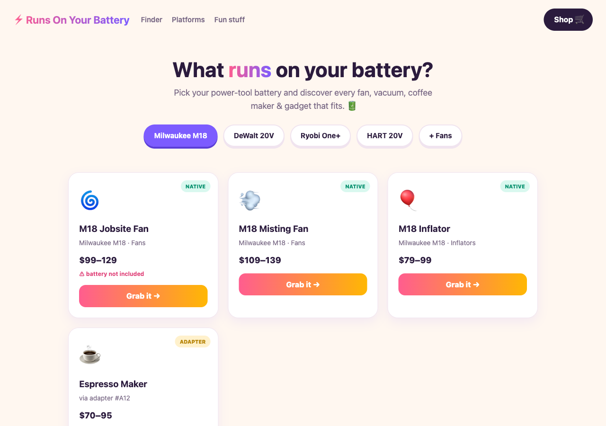

# Design gallery — house template directions (ranked)

**Ticket:** [09 — Design the house template shell + skin system](../issues/09-house-template.md)
**Purpose:** react-to-it gallery before committing the factory's canonical template. Eight rendered
directions on the same `runs-on-your-battery` content + a shelf of real-world exemplars.
**How to review:** open this file in Markdown preview (images inline), or open each
`variants/NN-*.html` in a browser. My ranking is below — yours overrides it.

---

## The lens I ranked by (factory, not one site)

This template is inherited by **every** future site (power tools, appliances, finance-style tools,
pet food, poems, agent-skills…). So a design is graded less on "is it pretty" and more on:

| Weight | Criterion | Why it matters here |
|---|---|---|
| ★★★ | **Themeability** | One template must re-skin across wildly different niches via tokens alone. A look that only works for *one* vibe is a poor factory base. |
| ★★★ | **Archetype-fit** | Must serve BOTH page types we ship: an **interactive tool** *and* a **long-tail directory/detail** page. |
| ★★ | **CWV-friendliness** | System fonts, no heavy assets, reserved space (research/03 + 07). Ranking budget: LCP ≤2.5s / CLS ≤0.1. |
| ★★ | **Trust / AdSense** | AdSense wants "fully built, high-quality" feel; affiliate needs credibility. Some looks read as thin/spammy. |
| ★ | **Conversion** | Guides the eye result → monetization holes without dark patterns. |
| ★ | **Mobile & a11y** | Contrast, focus, single-column reflow. |

Scores are 1–5. "Fit" = archetype-fit. "Theme" = themeability across niches.

---

## Scorecard (my ranking)

| # | Direction | Theme | Fit | CWV | Trust | Conv | **Total** | Best for |
|---|---|:--:|:--:|:--:|:--:|:--:|:--:|---|
| **08** | **App-shell sidebar** | 5 | 5 | 4 | 4 | 4 | **22** | The neutral factory default — tool + directory |
| **05** | **Card-grid catalog** | 5 | 4 | 4 | 4 | 5 | **22** | Product/image-heavy niches (appliances, pet food) |
| **02** | **Minimal calculator** (Groww) | 4 | 4 | 5 | 5 | 4 | **22** | Single-tool / calculator niches (finance, converters) |
| **01** | **Utilitarian dense** | 4 | 5 | 5 | 4 | 3 | **21** | Data/spec-heavy niches; power users |
| **03** | **Editorial magazine** | 4 | 3 | 3 | 5 | 4 | **19** | Guide/"best-of" layer; authority content |
| **06** | **Spec-sheet technical** | 3 | 4 | 4 | 4 | 3 | **18** | Technical/developer niches (e.g. agent-skills hub) |
| **07** | **Dark-first modern** | 3 | 4 | 3 | 3 | 4 | **17** | Gadget/gaming/dev niches only |
| **04** | **Playful consumer** | 3 | 3 | 3 | 2 | 5 | **16** | Fun/consumer niches; highest CTR, lowest authority |

Three-way tie at the top is deliberate — see the recommendation: they're not competitors, they're
**the three layout modes one themeable base should offer.**

---

## Each direction

### 08 — App-shell sidebar  ·  ⭐ my pick for the default

Left filter rail + main results pane, sticky, app-like. **Pros:** neutral enough to skin any direction;
handles both tool (filters) and directory (result list) natively; ad hole sits cleanly after results;
scales from 5 to 500 rows. **Cons:** sidebar needs a mobile collapse; can feel "generic SaaS" if the
skin doesn't add character. This is essentially my current prototype, refined.

### 05 — Card-grid catalog  ·  ⭐ co-pick (directory mode)

Top filter bar + responsive product-card grid. **Pros:** best when rows have images (appliances, pet
food, gadgets); very themeable; in-grid ad units are natural and high-CTR; screams "browse me". **Cons:**
weaker for pure-numeric tools; image-per-row raises the CWV/asset burden (needs strict `width/height`).

### 02 — Minimal calculator (Groww-inspired)  ·  ⭐ co-pick (tool mode)

Centered card, big controls, a viz, and a right rail with a **CTA card + "popular platforms" list**
(lifted straight from Groww — that rail is a perfect monetization + internal-link hole). **Pros:** best
CWV and trust; calm and premium; ideal for single-answer tools. **Cons:** not built for browsing a big
catalog; the "one big result" model doesn't fit directory niches.

### 01 — Utilitarian dense

Compact table, minimal chrome, function-first. **Pros:** top CWV, huge info density, reads as a serious
data tool; trivially themeable. **Cons:** plain/old-school out of the box; lowest conversion pull; tables
need care to reflow on mobile.

### 03 — Editorial magazine

Serif display, drop cap, ranked prose entries. **Pros:** highest perceived authority; ideal for the
"best M18 fans" guide layer and AdSense content-quality bar. **Cons:** serif = a webfont risk (mind
`font-display`); it's a *reading* layout, not a *tool* layout — better as the guide/blog skin than the
finder itself.

### 06 — Spec-sheet technical

Dark, monospace, database aesthetic with `native/direct/adapter` as code tags. **Pros:** distinctive;
perfect for technical niches (the agent-skills hub, compat matrices). **Cons:** narrow appeal; mono +
dark needs contrast/a11y care; doesn't read as "friendly consumer".

### 07 — Dark-first modern

Dark canvas, gradient glow, pill segments. **Pros:** modern, striking, good for gadget/gaming/dev
audiences. **Cons:** dark-first is a *taste*, not a universal default; gradients/glow fight CWV and can
dip below AdSense contrast expectations; least "trustworthy-neutral" for mass niches.

### 04 — Playful consumer

Gradient wordmarks, emoji, rounded cards, chunky CTAs. **Pros:** highest click energy; great for fun
consumer niches. **Cons:** reads as least authoritative — a real risk for AdSense approval and factual
trust; gradients/emoji everywhere are the hardest to make feel credible across niches.

---

## Real-world exemplars (inspiration shelf)

Screenshots saved under `exemplars/`. These informed the directions above; they are reference, not
candidates.

- **Groww SIP calculator** — `exemplars/groww-sip-calculator.png` — the clean/minimal benchmark you
  flagged. Took: the centered tool + **right-rail CTA & "popular calculators" list** → direction 02.
- **Omni Calculator (mortgage)** — `exemplars/omnicalculator-mortgage.png` — dense tool + long article
  below; shows how a calculator carries SEO content. Took: content-below-tool pattern.
- **RTINGS (best gaming TVs)** — `exemplars/rtings-best-gaming-tvs.png` — data-heavy review/directory;
  ranked cards + spec tables. Took: ranked-entry + dense-spec ideas → directions 03 & 01.
- **PCPartPicker (filterable parts directory)** — *bot-blocked (Cloudflare 403), referenced by URL:*
  <https://pcpartpicker.com/products/cpu/> — the archetype twin of our finder (facet filters + sortable
  table + per-row buy). Informs directions 08 & 05.

---

## My recommendation

**Don't pick one skin — adopt one themeable base with two selectable layout modes.**

The top three aren't rivals; they're the three shapes our niches actually need:

1. **Base = App-shell sidebar (08)** as the neutral, tokenized default.
2. **Layout mode toggle per site:** **results-list** (08/01) for spec/tool niches vs **card-grid** (05)
   for image/product niches — same tokens, same components, one flag.
3. **Tool-hero mode (02)** as the variant for single-calculator niches, reusing the same tokens + the
   Groww right-rail hole.
4. **Editorial (03)** becomes the **guide/blog skin**, not the finder — it's the content layer that wins
   AdSense trust and links into the tool.
5. Keep **06/07/04** as **pre-built skins** the token system can reach (technical / dark / playful) for
   niches that want them — proving the skin system's range without being the default.

Net: the factory ships **one shell**, **two layout modes**, and a **skin palette** (neutral, editorial,
technical, dark, playful). That's what makes it a *factory* rather than one site's look.

**Over to you:** tell me which direction(s) feel right — pick one, bless the "base + modes" plan, or
mix (e.g. "08 base, 05 for product niches, 02 rail for the monetization hole"). I'll fold the verdict
into the real house template and resolve ticket 09.
